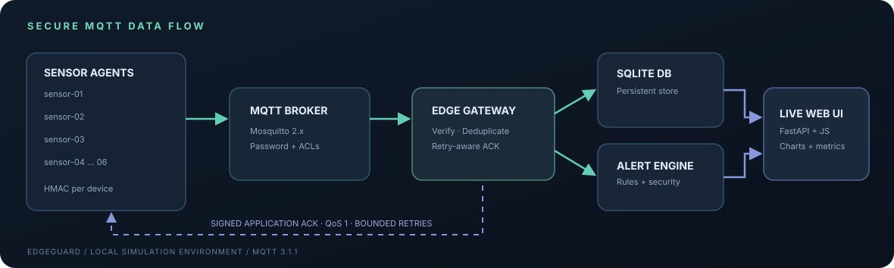

<div align="center">

# 🛡 EdgeGuard

### Secure Real-Time Sensor Network

**A production-pattern IoT edge monitoring simulator with MQTT, authenticated sensor telemetry, application-level ACKs, packet-loss injection, reliable retries, persistent storage, alerts and a live web console.**

`Python 3.12` · `MQTT 3.1.1` · `Mosquitto` · `FastAPI` · `SQLite` · `Docker Compose` · `HMAC-SHA256`

</div>

---

## Architecture



| Layer | Implementation |
|---|---|
| **Sensors** | Six independent simulated agents with realistic temperature, humidity, vibration and battery telemetry |
| **Messaging** | Eclipse Mosquitto MQTT broker with authenticated connections, ACLs and QoS 1 |
| **Security** | Per-node derived HMAC-SHA256 keys, freshness validation, signed ACKs and bounded input validation |
| **Edge** | Verification, de-duplication, anomaly detection, packet/ACK loss injection |
| **Reliability** | Application-level retry with sequence tracking, bounded retries, at-least-once attempts and effectively-once storage |
| **Persistence** | SQLite with unique sequence constraints, indexes and WAL |
| **Visualization** | Responsive vanilla HTML/CSS/JS monitoring console with charts, device table, events and retry statistics |
| **Testing** | Pytest unit tests, a broker-free smoke demo and GitHub Actions |

## Quick start — Docker (recommended)

**Requirements:** Docker Desktop or Docker Engine with the `docker compose` plugin, available ports `8080` and `1883`.

```bash
# 1. Clone/download the project and open its directory
cd EdgeGuard

# 2. Generate private demo secrets (recommended)
python3 scripts/generate_env.py

# 3. Launch broker + API + simulator
#    If you do not generate .env, the demo-only fallback credentials are used.
docker compose up --build -d

# 4. See logs
docker compose logs -f gateway simulator broker
```

Open **http://localhost:8080** to view the dashboard. Open **http://localhost:8080/docs** for Swagger/OpenAPI.

Sensor agents appear and transmit automatically after the services connect. It is normal to observe occasional retries, simulated drops and alert events. The gateway persists state between container restarts in a Docker volume.

```bash
# Stop services
docker compose down

# Stop services AND delete the database and broker volumes (destructive)
docker compose down -v
```

> **Security:** The broker and dashboard bind to `127.0.0.1` on the host. Demo traffic inside Docker is NOT TLS encrypted and the dashboard's read endpoints are unauthenticated; this is not configured for exposure to the public internet. Generate a private `.env` before use, and see [production considerations](#security--limitations).

## Dashboard

The interface shows **online sensor count**, **ingested packet count**, **gateway latency average and P95**, **five-minute throughput/latency charts**, live per-node telemetry, threshold/security alerts, duplicate frame counts, retry totals, simulated loss counts and delivery failures.

Try the **illustrative design preview** after starting the server at `http://localhost:8080/?preview=1`. Preview numbers are synthetic and clearly marked; the normal `/` route uses live REST API data.

To acknowledge an alert, click **Acknowledge** and enter `DASHBOARD_API_TOKEN` from your private `.env` when prompted. The token is held in JavaScript memory for that browser tab session, not included in the webpage or source code.

### Network protocol

| Topic | Publisher | Subscriber |
|---|---|---|
| `edgeguard/telemetry/sensor-01` | `sensor-01` | gateway |
| `edgeguard/health/sensor-01` | `sensor-01` | gateway |
| `edgeguard/acks/sensor-01` | gateway | `sensor-01` |

Broker MQTT accounts are required and ACL rules restrict individual sensor usernames to their own topics. Signed telemetry also binds the claimed node identity cryptographically, and ACKs are verified by the sensor before declaring delivery complete.

### Simulating network unreliability

Modify `.env` and restart affected containers:

```dotenv
NODE_COUNT=6
PACKET_LOSS_RATE=0.12
ACK_DROP_RATE=0.16
SENSOR_INTERVAL=2.0
RETRY_TIMEOUT=1.5
MAX_RETRIES=3
```

- `PACKET_LOSS_RATE`: probability that a sensor skips one publish attempt entirely.
- `ACK_DROP_RATE`: probability that a gateway deliberately suppresses one signed application ACK.
- `MAX_RETRIES`: **additional** retries after the first send (3 means up to 4 total attempts).
- `RETRY_TIMEOUT`: seconds to await a valid ACK before retransmitting.

Example: Increase `ACK_DROP_RATE` to `0.65`, run `docker compose up -d --force-recreate gateway`, and watch duplicate frames and ACK retry metrics rise. Increase `PACKET_LOSS_RATE` to `0.60` and recreate the simulator to observe delivery retries and eventual failure counts.

**Correctness model:** MQTT QoS 1 confirms broker delivery, not application persistence. EdgeGuard adds a signed application ACK after database insertion, and `UNIQUE(node_id, seq)` protects storage from duplicate packets. Since the retry budget is finite, a persistent outage can still cause delivery failure. See the full [delivery semantics](docs/ARCHITECTURE.md).

## Development without Docker

Install Python 3.10+ and Mosquitto, and prepare broker accounts and ACLs following the supplied `mosquitto/` configuration. Docker is the easiest way to avoid this manual broker setup.

```bash
python3 -m venv .venv
source .venv/bin/activate
pip install -r requirements-dev.txt

# Load the environment for both processes (Linux/macOS shell)
set -a; source .env; set +a

# Set MQTT_HOST=localhost; broker should run separately
export MQTT_HOST=localhost
python -m edgeguard gateway
# In a second terminal, from the same activated environment:
python -m edgeguard simulate
```

The gateway listens on port `8080`; use the `--port` flag for a different port. The local broker must have MQTT users `gateway`, `sensor-01` through `sensor-06` and the ACLs in `mosquitto/acl`. `compose.yaml` automatically handles this setup when using Docker.

## Testing

```bash
pip install -r requirements-dev.txt
python -m pytest -q
python -m scripts.offline_demo
node --check web/assets/app.js    # optional, if Node.js is installed
```

The offline demo uses the **real signature validation, gateway ingestion and SQLite code** but substitutes an in-process publish callback for an MQTT broker. It confirms 60 distinct authenticated readings, three duplicate frames, signed ACK production and rule-based alerts. The unit tests also exercise packet forgery, mismatched identities, timestamp limits, replay-like duplicate handling, persistence across gateway restarts, lost ACKs, bounded retry exhaustion, REST endpoint responses and bearer token authorization.

Continuous integration is configured in `.github/workflows/tests.yml` and runs tests on push/pull request.

## REST API

| Method | Endpoint | Details |
|---|---|---|
| GET | `/api/health` | Service and MQTT connection state |
| GET | `/api/overview` | Counts, p95, active nodes, alerts, retry and loss aggregates |
| GET | `/api/nodes` | Latest node readings and health counters |
| GET | `/api/telemetry?limit=60` | Most recent persisted readings, up to 500 |
| GET | `/api/alerts?limit=30` | Security and threshold incidents |
| GET | `/api/trends` | Thirty buckets over the last five minutes |
| GET | `/api/config` | Public simulator settings, no secrets |
| POST | `/api/alerts/{id}/ack` | Acknowledge with `Authorization: Bearer <DASHBOARD_API_TOKEN>` |
| GET | `/docs` | Interactive OpenAPI documentation |

Example:

```bash
curl http://localhost:8080/api/overview
curl http://localhost:8080/api/nodes
curl http://localhost:8080/api/trends
```

## Repository structure

```text
EdgeGuard/
├── edgeguard/
│   ├── __main__.py       # gateway/simulate CLI
│   ├── api.py            # FastAPI endpoints & static web console
│   ├── config.py         # environment settings
│   ├── gateway.py        # MQTT subscriber, validation, dedup, alerts, ACKs
│   ├── security.py       # HMAC signing/verification + payload limits
│   ├── simulator.py      # multi-node MQTT publisher + retry state machine
│   └── store.py          # SQLite persistence + metric aggregation
├── web/
│   ├── index.html        # monitoring dashboard
│   └── assets/           # CSS, JavaScript, favicon
├── mosquitto/            # broker configuration and ACLs
├── docs/                 # architecture documentation and diagram
├── tests/                # automated security, network, API and retry tests
├── scripts/              # private secret generation + offline demo
├── .github/workflows/    # GitHub Actions testing
├── compose.yaml          # broker + gateway + simulator + auth bootstrap
├── Dockerfile
├── Makefile
├── requirements.txt
├── requirements-dev.txt
└── .env.example
```

## Security & limitations

This repository is **a functional educational simulation, not a certified production IoT security system**. Its authentication and reliability properties are explicitly implemented, but a live deployment would additionally require:

1. MQTT TLS/mTLS, HTTPS and cert rotation for non-local transports.
2. Unique, independently provisioned MQTT passwords for every node (the demo uses individual usernames but a common sensor password), plus secret management and rotation.
3. Authentication/authorization for read-only dashboard and metrics endpoints, request rate limiting and audit logging.
4. Time synchronization for meaningful one-way latency measurement; the current dashboard uses wall-clock timestamp subtraction and simulator ACK RTT is tracked separately.
5. Persistent node-side sequence/state management for exact reboot semantics, secure device bootstrapping and a stronger long-term reconnect/offline queue policy.
6. Production observability, centralized logs, alert notification channels and deployment-specific threat modeling.

The current implementation's **at-least-once attempts with finite retries are not equivalent to guaranteed delivery**. With sustained packet loss, samples can be lost; the simulator reports failed deliveries. Signing detects modifications but does not encrypt the telemetry. The application dashboard is reachable only through loopback host port mappings in the provided Compose setup.

## Live latency and reliability benchmark

While the Docker stack is running, collect new gateway readings into a CSV and a machine-readable summary:

```bash
python -m scripts.latency_report --seconds 30 --poll 2 --out results/latency_report.csv
```

The report includes mean, median, P95 and maximum ingestion latency, active nodes, retries, packet drops, duplicate frames and failures observed across the measurement interval. Files are written to `results/` (which is ignored by Git); use a longer interval to gather more readings. The benchmark observes the real MQTT-fed backend through HTTP but does not replace a hardware clock-synchronized network latency test.

---

<div align="center">

Built to demonstrate **IoT edge computing · secure messaging · resilience engineering · real-time observability**.

MIT licensed. See [LICENSE](LICENSE).

</div>
