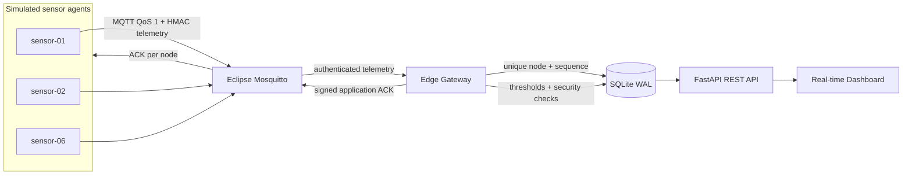

# Architecture and delivery semantics



## Topics and permissions

| MQTT client | Publish | Subscribe |
|---|---|---|
| `gateway` | `edgeguard/acks/+` | `edgeguard/telemetry/+`, `edgeguard/health/+` |
| `sensor-NN` | `edgeguard/telemetry/sensor-NN`, `edgeguard/health/sensor-NN` | `edgeguard/acks/sensor-NN` |

Broker ACLs enforce topic-level isolation using `%u` (MQTT account username). Demo sensors have separate usernames but one demo password; provision unique node credentials for production.

## Telemetry frame

The signed payload is canonical JSON (sorted keys, compact separators) with an HMAC-SHA256 hex digest in `mac`. Each node derives an independent signing key from the gateway master key using `HMAC(master, "edgeguard:v1:" + node_id)`.

```json
{
  "kind": "telemetry",
  "node_id": "sensor-01",
  "seq": 1923230123123,
  "attempt": 1,
  "temperature": 26.1,
  "humidity": 47.2,
  "vibration": 2.9,
  "battery": 91.0,
  "generated_at": 1793098321.5,
  "sent_at": 1793098321.52,
  "mac": "<64-character HMAC-SHA256 hex digest>"
}
```

## Reliability, retries and duplicates

1. Node samples one reading and assigns a unique sequence number.
2. A simulator-induced drop may skip the MQTT publication entirely; otherwise node publishes with QoS 1.
3. Gateway verifies the node/topic, message MAC, timestamp freshness (±120 seconds) and measurement schema.
4. Gateway inserts the reading with a `(node_id, seq)` unique constraint. This guarantees idempotent ingestion even after a retransmission or gateway restart.
5. Gateway signs `ack { node_id, seq, status: stored, sent_at }` with that node's key, and publishes it with MQTT QoS 1. Another fault injector may deliberately suppress it.
6. Node accepts only a matching, signed ACK. If none arrives before timeout, it retransmits the same reading/sequence (with the new attempt number), up to `MAX_RETRIES` additional times.
7. Retransmissions are recorded as duplicates and **re-acknowledged**. A successful acknowledgement or exhausted retry budget closes the sample.

**Guarantee:** At-least-once delivery attempts, effectively-once storage for a given node/sequence, **not** unconditionally guaranteed delivery during long outages. With finite retries and/or complete link failure, loss can occur. The simulator reports `failed` when that happens.

## Alerts

- Temperature ≥36°C: warning.
- Vibration ≥7 mm/s: critical.
- Battery ≤20%: warning.
- Invalid MAC, identity, schema, stale timestamp or topic: critical security alert.
- Alert emission is rate-limited per `(node, kind)` using a persistent cooldown.
- Alert acknowledgement uses the dashboard token on a POST endpoint.

## Metrics

`latency_ms = max(0, gateway_receive_wall_clock - sensor_generated_wall_clock) * 1000`. This is **not** a clock-synchronized one-way latency benchmark; for physically separate hosts use NTP/PTP or a two-way RTT. Simulator additionally tracks application acknowledgement RTT in its health message. The dashboard reports a sample average and nearest-rank p95 over the last 500 persisted readings, a rolling 60-second throughput count and five-minute chart buckets. Loss and retry counts are sent by simulator health frames and can lag or reset when a node process restarts.

## Security boundaries

- MQTT password file disables anonymous connections.
- Mosquitto ACLs restrict topic access by MQTT client identity.
- Node HMAC signatures protect application-level integrity and prove possession of the derived node key.
- Node timestamps reject old and future-dated packets (subject to clock synchronization).
- Authenticated application ACKs prevent unsigned spoofing from marking an unreceived packet delivered.
- Gateway applies payload-size and numeric-range validation.
- The dashboard acknowledgement endpoint uses a bearer token; read-only APIs are intentionally available to anyone who can reach its port.

**Development environment, not internet-hardened:** Compose binds HTTP and MQTT ports to local loopback, but traffic within the Docker network is unencrypted. Add MQTT TLS/mTLS, HTTPS via a reverse proxy, unique node passwords, secret manager, authenticated read endpoints, rate limiting and network segmentation for a real deployment. Prevent arbitrary access to both the `.env` file and MQTT traffic; HMAC alone does not encrypt messages. The preview screen is simulated illustrative data, not real measurements.
